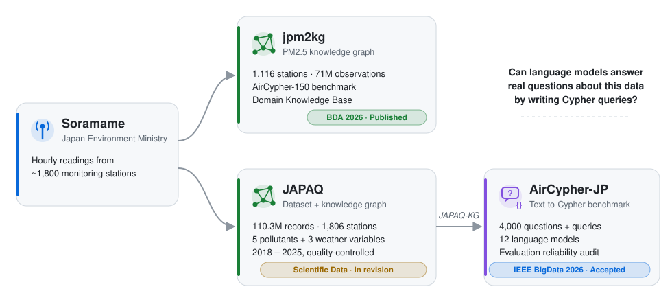

  <picture>
    <source media="(prefers-color-scheme: dark)" srcset="https://raw.githubusercontent.com/aircypher/.github/main/profile/assets/aircypher-logo-dark.svg">
    
  </picture>

  <b>Japan's air quality as a knowledge graph you can question in plain English.</b> 
  Open datasets, knowledge graphs and text-to-Cypher benchmarks built from Japan's national air quality monitoring network.

---

Japan publishes hourly air quality readings from about 1,800 monitoring stations. AirCypher turns
those readings into clean, documented datasets and Neo4j knowledge graphs, then uses them to study
a practical question: **how well can language models answer real questions about this data by
writing graph queries (Cypher)?**

Each project here is the reproducibility package for a paper, with the data, code and results
needed to check every reported number.

### Projects

| Project | What it is | Paper | Status |
|---|---|---|---|
| [**JAPAQ**](https://github.com/aircypher/JAPAQ) | The dataset and knowledge graph: 110.3 million hourly records from 1,806 stations (2018–2025), five pollutants and three weather variables, with documented quality control. Available as a table (JAPAQ-FE) and a Neo4j graph (JAPAQ-KG). | *Scientific Data* | In revision · release pending |
| [**AirCypher-JP**](https://github.com/aircypher/AirCypher-JP) | A benchmark of 4,000 English questions paired with Cypher queries over JAPAQ-KG. It evaluates 12 language models and measures how much the evaluation pipeline itself moves their scores. | IEEE BigData 2026 | Accepted · release pending |
| [**jpm2kg**](https://github.com/aircypher/jpm2kg) | A PM2.5 knowledge graph (1,116 stations, 71 million observations) with AirCypher-150, a 150-question benchmark, and a Domain Knowledge Base that helps models write correct queries. | BDA 2026, Goa | Published · public |

Repositories marked "release pending" will become public once their papers are published.

### How the projects fit together

  <picture>
    <source media="(prefers-color-scheme: dark)" srcset="https://raw.githubusercontent.com/aircypher/.github/main/profile/assets/aircypher-projects-dark.svg">
    
  </picture>

### Research team

Arjun Chakravarthi Pogaku and Uday Kiran Rage, University of Aizu, with collaborators named in each paper.

---

Maintained by <a href="https://arjunpogaku.github.io">Arjun Pogaku</a>. Each repository states its own license for code and data.
